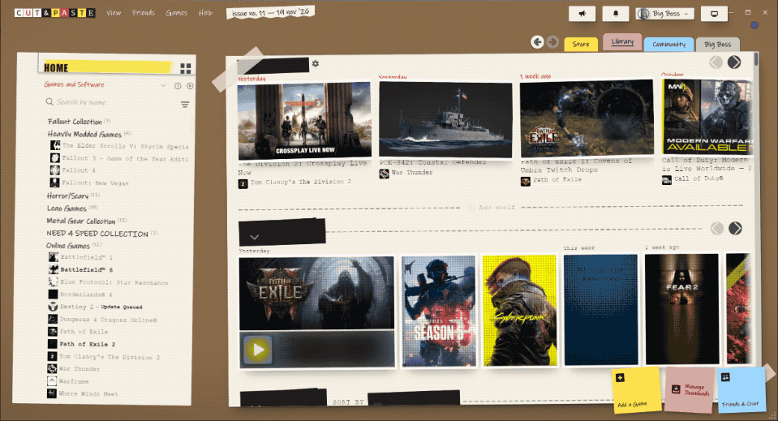
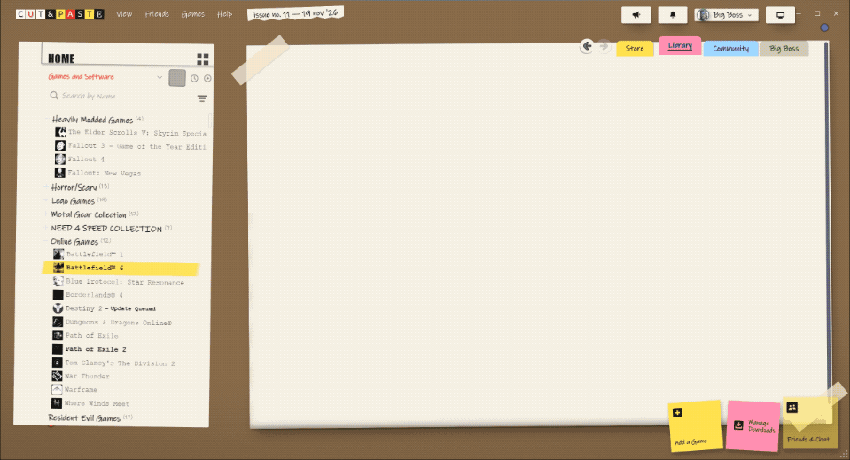

# Cut & Paste

**Your library as a zine collage, pinned to a cork board.** A [Millennium](https://steambrew.app) theme for the Steam client.

- **A deliberately off-grid layout:**
  - The game list is a lined **notebook page** with spiral holes and a red margin, tilted one way.
  - The page is a **sheet of paper** tilted the other way, with tape on its corners.
  - Store / Library / Community / You are **colored index tabs** poking out of the sheet's edge.
  - The dock is three **sticky notes**.
- **A ransom-note wordmark** built from mismatched cut-out letters, plus an "issue no." date scrap.
- **Ink on paper:** text is dark ink. The selected game gets a **highlighter swipe**, and hovered names get a wavy red underline.
- **Covers** are printed with **halftone dots** that clear on hover, and they wobble when you touch them.
- **Play** is a cut-out red **PLAY!** label with a strip of tape. Headings are cut from black and yellow paper.
- Things **stick on** with a little overshoot instead of fading in. The intro flies cut-out letters onto the board.

## Install

1. Install [Millennium](https://steambrew.app).
2. Find **Cut & Paste** in the Millennium theme browser, or download this repository into `Steam/millennium/themes/CutPaste`.
3. Open **Steam → Millennium → Themes** and pick **Cut & Paste**.

## Options

Open **Millennium → Themes → Cut & Paste** to change:

Paper (Cork, Newsprint, Risograph, Kraft) · Tilt (Crooked / Straight) · Halftone covers · Pins · Density · What's New · Readout · Startup screen · Motion · Cover hover · Privacy

Everything here is original: no other game's names, logos, art or fonts. Fonts are ones that ship with Windows.

## License

MIT, see [LICENSE](LICENSE).
